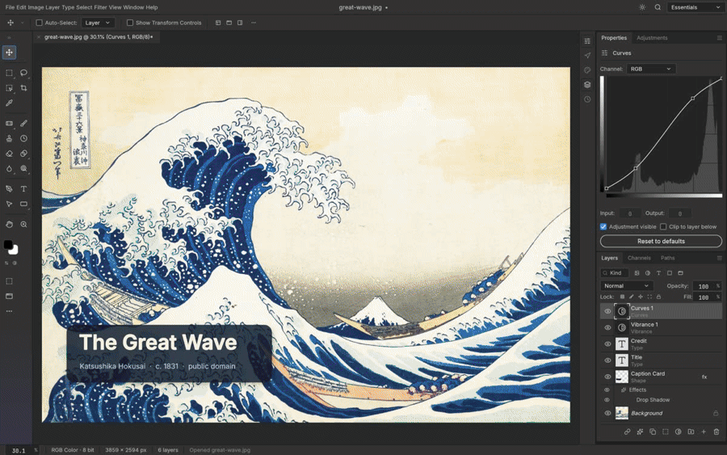

<p align="center">
  
</p>

<p align="center">
  <b>Photo · Vecteur · Vidéo · Développement photo · PDF · Motion design · Mise en page<br>
  Traitement de texte · Présentations · Tableur · DAO · Son · Design d'interfaces · Textures et matériaux 3D<br>
  Animation 2D · BIM et architecture</b><br>
  Sur Mac (puce Apple et Intel), sans abonnement, sans compte, et pilotables par Claude.
</p>

<p align="center">
  <a href="#installer-en-une-ligne"><b>Installer</b></a> ·
  <a href="#les-apps">Les apps</a> ·
  <a href="#repris-et-amélioré">Repris et amélioré</a> ·
  <a href="https://github.com/axsomette/lucraft-releases/releases/latest">Dernière version</a>
</p>

---

<p align="center">
  
</p>

## Installer en une ligne

Ouvrez le **Terminal** (⌘ + Espace, tapez « Terminal »), collez cette ligne puis Entrée :

```bash
curl -fsSL https://raw.githubusercontent.com/axsomette/lucraft-releases/main/install.sh | bash
```

**Lucraft Launcher** s'installe dans Applications. Cliquez « Installer » sur les apps que vous voulez :
c'est tout. Ensuite tout se met à jour **tout seul** : les apps, et le launcher lui-même.

> macOS 11 ou plus récent, sur Mac à puce Apple (M1, M2, M3, M4…) ou Intel. Chaque téléchargement est
> vérifié (empreinte SHA-256) avant d'être installé.

## Ce que vous y trouvez

### Claude aux commandes
Chaque app embarque un **serveur MCP**. Le launcher relie une app à Claude Desktop ou à Claude Code
**en un clic**, et Claude ouvre, crée, retouche et exporte **dans les vraies apps**. Une phrase suffit :
*« décline ce visuel en story, post Instagram et affiche A4 aux couleurs du client »*. En mode « en
direct », vous voyez Claude travailler dans la fenêtre de l'app.

### Chartes clients
Couleurs, typographies, logos, gabarits et règles d'usage rangés par client. Les apps et Claude les
respectent à chaque création, et Claude sait remplir une charte tout seul à partir d'un design system.

### Déclinaisons automatiques
Un visuel, quatorze formats : réseaux sociaux, print (PDF/X), bannières, présentations… en une demande.

### IA locale, sur votre Mac
Transcription et sous-titres (**Whisper**), voix off naturelles (**Kokoro**), détourage et suivi de
visages dans les vidéos (**MobileSAM**, **MediaPipe**). Tout tourne en local : vos fichiers ne partent
nulle part.

### Blender intégré
Le launcher installe et met à jour **Blender** depuis blender.org, et peut le brancher à Claude grâce au
serveur MCP officiel de Blender Lab : modélisation, éclairage et rendu 3D pilotés en langage naturel.

### Compatible avec vos fichiers
Ouverture et enregistrement **PSD** (calques, masques, styles), **.ai** et **EPS** (calques, tracés,
dégradés, plans de travail), PDF, DOCX, PPTX, XLSX, DXF, IFC, SVG…

### Natives et rapides
Écrites en **Rust**, sans Electron : des apps légères qui démarrent vite et tournent hors ligne.

## Les apps

| | App | Pour |
|:-:|---|---|
|  | **PhotoLucraft** | Retouche et composition d'images |
|  | **VectorLucraft** | Illustration vectorielle, logos |
|  | **FilmLucraft** | Montage vidéo, sous-titres, voix off |
|  | **LightLucraft** | Photothèque et développement RAW |
|  | **PdfLucraft** | Édition de PDF, OCR |
|  | **EffectLucraft** | Motion design et effets visuels |
|  | **DesignLucraft** | Mise en page, print |
|  | **WordLucraft** | Traitement de texte |
|  | **DeckLucraft** | Présentations |
|  | **GridLucraft** | Tableur et données |
|  | **CADLucraft** | Dessin technique 2D et 3D |
|  | **SoundLucraft** | Enregistrement, montage et mixage audio |
|  | **FigLucraft** | Design d'interfaces et prototypage |
|  | **Blender** | 3D (version officielle de blender.org) |

### Nouvelles, en bêta

Elles s'installent depuis le launcher comme les autres ; le badge BÊTA dit qu'elles sont encore jeunes.

| | App | Pour |
|:-:|---|---|
|  | **TextureLucraft** `BÊTA` | Peinture de textures 3D |
|  | **MaterialLucraft** `BÊTA` | Matériaux procéduraux par nœuds |
|  | **AniLucraft** `BÊTA` | Animation vectorielle 2D |
|  | **Lucraft Anything** `BÊTA` | L'IA étudie un site ou une app et en construit sa version avec Claude Code |
|  | **ArchiLucraft** `BÊTA` | Maquettes BIM : ouvrir, relire et corriger des fichiers IFC |
|  | **ConstructLucraft** `BÊTA` | Conception de bâtiment pour architectes (licence GPL, code source publié avec l'app) |
|  | **ModelLucraft** `BÊTA` | Maquettage 3D direct : dessiner, pousser, tirer, grouper, exporter |
|  | **MarkupLucraft** `BÊTA` | Annoter et vérifier des plans PDF : mesures à l'échelle, statuts, export CSV et BCF |

### Bientôt

D'autres apps arrivent.

## Repris et amélioré

J'ai repris des logiciels créatifs libres, je les ai renommés, sécurisés, reliés à Claude et réunis dans
une suite. Ce que j'y ai ajouté :

- **Un launcher pour toute la suite.** Il installe les apps et les met à jour tout seul (versions
  précompilées pour Mac Apple et Intel, intégrité vérifiée par empreinte SHA-256), et relie chaque app
  à Claude en un clic, dans Claude Desktop et Claude Code.
- **La sécurité.** Les failles sont corrigées ou évaluées une par une. Celle, critique, de la
  bibliothèque zip est corrigée dans 6 apps, alors que la version d'origine ne l'était pas encore au
  9 novembre 2026. Le launcher ne parle qu'à sa source (verrou réseau). Les mises à jour automatiques et
  les liens externes de l'origine sont retirés, les apps sont hors ligne par défaut, et les fonctions en
  ligne passent par une liste fermée de services.
- **Une reprise chaque semaine, automatisée.** Chaque nouvelle version de l'origine est récupérée,
  renommée, testée (plus de 60 000 tests par reprise) et publiée en quelques heures. Une nouvelle app
  rejoint la suite dans la journée de sa sortie.
- **Des correctifs propres** : des tests qui ne compilaient pas sur Mac, le contrôle de signature des
  images disque, le plein écran du launcher, entre autres.
- **Des icônes gravées par un programme** : une gravure sur bois calculée par un script, sans IA. Chaque
  app a son objet du métier (objectif, bobine, plume, compas, truelle…) sur une tuile de couleur à elle.
- **Un badge BÊTA** sur les apps encore jeunes, pour savoir à quoi s'attendre.

## À propos de ce dépôt

Ce dépôt ne contient que les versions prêtes à installer (DMG et outils en ligne de commande). Lucraft
est construit sur des briques open source, sous licences MIT ou Apache-2.0 pour la plupart : les licences
et attributions de chaque app sont livrées avec elle. ConstructLucraft est sous licence GPL : son code
source est publié avec chaque version, dans les fichiers de la publication. Blender est la version
officielle de la Blender Foundation, sous licence GPL, téléchargée directement depuis blender.org.

<p align="center"><sub>Lucraft est un projet personnel de <a href="https://axsomette.github.io/lucas-jimenez-boulot/">Lucas Jimenez Boulot</a>.</sub></p>
