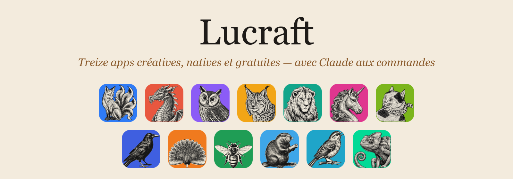
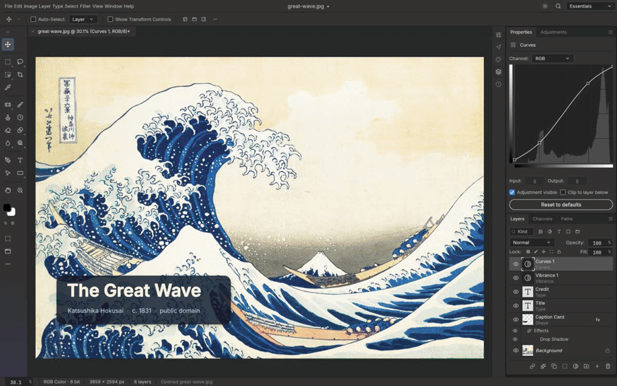

<p align="center">
  
</p>

<p align="center">
  <b>Photo · Vecteur · Vidéo · Développement photo · PDF · Motion design · Mise en page<br>
  Traitement de texte · Présentations · Tableur · DAO · Son · Design d'interfaces</b><br>
  Natives sur Mac (puce Apple et Intel), sans abonnement, sans compte, et pilotables par Claude.
</p>

<p align="center">
  <a href="#installer-en-une-ligne"><b>Installer</b></a> ·
  <a href="#ce-qui-change-tout">Nouveautés</a> ·
  <a href="#les-apps">Les apps</a> ·
  <a href="https://github.com/axsomette/lucraft-releases/releases/latest">Dernière version</a>
</p>

---

<p align="center">
  
</p>

## Installer en une ligne

Ouvrez le **Terminal** (⌘ + Espace, tapez « Terminal »), collez cette ligne puis Entrée :

```bash
curl -fsSL https://raw.githubusercontent.com/axsomette/lucraft-releases/main/install.sh | bash
```

**Lucraft Launcher** s'installe dans Applications. Cliquez « Installer » sur les apps que vous voulez :
c'est tout. Ensuite tout se met à jour **tout seul** : les apps, et le launcher lui-même.

> macOS 11 ou plus récent, sur Mac à puce Apple (M1, M2, M3, M4…) ou Intel. Chaque téléchargement est
> vérifié (empreinte SHA-256) avant d'être installé.

## Ce qui change tout

### 🤖 Claude aux commandes des 13 apps
Chaque app embarque un **serveur MCP** : Claude (Claude Desktop, Claude Code, ou « Demander à Claude »
directement dans le launcher) ouvre, crée, retouche et exporte **dans les vraies apps**. Une phrase
suffit : *« décline ce visuel en story, post Instagram et affiche A4 aux couleurs du client »*.
En mode « en direct », vous voyez Claude travailler dans la fenêtre de l'app.

### 🎨 Chartes clients
Couleurs, typographies, logos, gabarits et règles d'usage rangés par client. Les apps et Claude les
respectent à chaque création, et Claude sait remplir une charte tout seul à partir d'un design system.

### 📐 Déclinaisons automatiques
Un visuel, quatorze formats : réseaux sociaux, print (PDF/X), bannières, présentations… en une demande.

### 🧠 IA locale, sur votre Mac
Transcription et sous-titres (**Whisper**), voix off naturelles (**Kokoro**), détourage et suivi de
visages dans les vidéos (**MobileSAM**, **MediaPipe**). Tout tourne en local : vos fichiers ne partent
nulle part.

### 🧊 Blender intégré
Le launcher installe et met à jour **Blender** depuis blender.org, et peut le brancher à Claude grâce au
serveur MCP officiel de Blender Lab : modélisation, éclairage et rendu 3D pilotés en langage naturel.

### 🔁 Compatible avec vos fichiers
Ouverture et enregistrement **PSD** (calques, masques, styles), **.ai** et **EPS** d'Illustrator (calques,
tracés, dégradés, plans de travail), PDF, DOCX, PPTX, XLSX, DXF, SVG…

### ⚡ Natif et rapide
Écrites en **Rust**, sans Electron : des apps légères qui démarrent vite et tournent hors ligne.

## Les apps

| | App | Pour |
|:-:|---|---|
|  | **PhotoLucraft** | Retouche et composition d'images |
|  | **VectorLucraft** | Illustration vectorielle, logos |
|  | **FilmLucraft** | Montage vidéo, sous-titres, voix off |
|  | **LightLucraft** | Photothèque et développement RAW |
|  | **PdfLucraft** | Édition de PDF, OCR |
|  | **EffectLucraft** | Motion design et effets visuels |
|  | **DesignLucraft** | Mise en page, print |
|  | **WordLucraft** | Traitement de texte |
|  | **DeckLucraft** | Présentations |
|  | **GridLucraft** | Tableur et données |
|  | **CADLucraft** | Dessin technique 2D/3D |
|  | **SoundLucraft** | Enregistrement, montage et mixage audio |
|  | **FigLucraft** | Design d'interfaces et prototypage |
|  | **Blender** | 3D (version officielle de blender.org) |

## D'où vient Lucraft

Lucraft est construit sur la suite open source **ArtCraft** (« Crafting Apps », licences MIT ou
Apache-2.0), reprise, adaptée et enrichie avec l'aide de Claude : le launcher, le branchement à Claude,
les chartes, les déclinaisons, l'IA locale et Blender sont propres à Lucraft. Les nouveautés et
corrections d'ArtCraft sont reprises régulièrement, vérifiées app par app avant publication.

Ce dépôt ne contient que les versions prêtes à installer (DMG et outils en ligne de commande) ; les
licences et attributions de chaque app sont livrées avec elle. Blender est la version officielle de la
Blender Foundation, sous licence GPL, téléchargée directement depuis blender.org.
